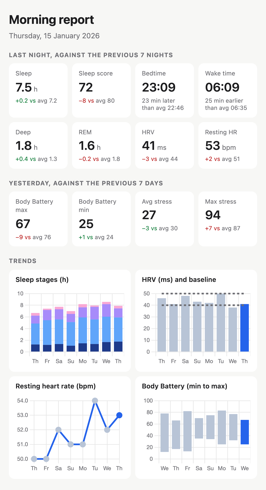

# garmin-api

Morning report from the [Garmin Connect Personal API](https://developer.garmin.com/gc-developer-program/personal/personal-api/): last night's sleep, HRV and resting HR, plus yesterday's Body Battery and stress, each against the previous 7 days. Opens as an HTML page or is sent to Telegram as an image.



## Setup

```sh
make sync browser
```

`.env`:

```sh
GARMIN_PERSONAL_API_KEY=...
TELEGRAM_BOT_TOKEN=...
TELEGRAM_CHAT_ID=...
```

## Commands

- `make report`: HTML report, opened in the browser
- `make message`: render the Telegram image to `data/` (dry run)
- `make message-send`: render and send to Telegram
- `make run` / `make explore`: connection check / save raw API responses to `data/`

## Schedule

`.github/workflows/morning-report.yml` runs daily at 05:30 UTC+2 and polls until last night's data is in, giving up at 09:00. It needs the three `.env` values as repository secrets.

## Notes

- No sleep stage timeline in the API, only totals per stage.
- Last night is final when today's sleep record has a `_final` confirmation type, a score, and an HRV summary.
- Rate limits aren't documented; calls retry on 429 and 5xx.

## Links

- [Swagger docs](https://developer.garmin.com/gc-developer-program/personal/swagger-docs/)
- [connect-personal-api-python](https://github.com/garmin/connect-personal-api-python)
